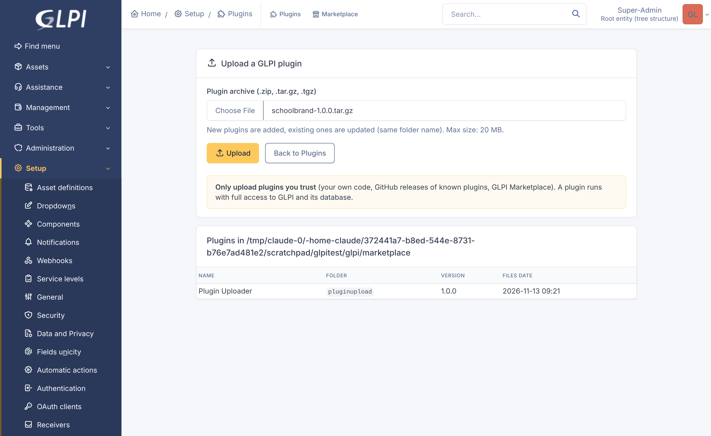
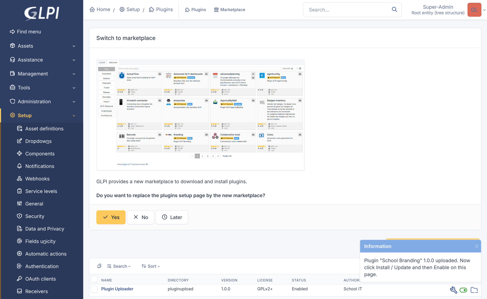
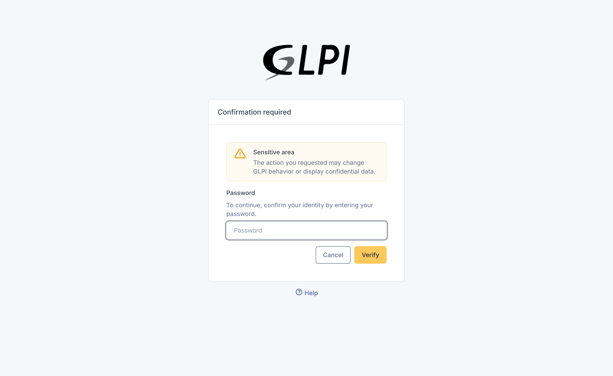

# GLPI Plugin Uploader

Install and update GLPI plugins **from the browser** by uploading a `.zip` or `.tar.gz` file – no SSH, no `docker cp`.

Tested on **GLPI 12.0.1** (works on GLPI 11.0+ / 12.x, PHP 8.2+).



## Features

- Upload `.zip`, `.tar.gz`, `.tgz`, `.tar.bz2` or `.tar`
- **New plugins are added, existing ones are updated** (same plugin folder)
- Detects the plugin automatically from `setup.php`, also in GitHub archives (`myplugin-main/` is installed as `myplugin`)
- Installs into GLPI's `marketplace` folder – the same place the official GLPI Marketplace uses, so plugins survive Docker image updates when that folder is a volume
- Registers the plugin in GLPI, so it appears at once in **Setup → Plugins** ready for **Install / Enable**
- Shows the list of plugins in the marketplace folder with versions



## Security

- Only users with **Setup → General → Update** rights (Super-Admin) can open the page
- On GLPI 12 the page asks for the **password again** (GLPI's "Sensitive area" re-authentication), like the core Plugins page

  
- Archives with unsafe paths (`../`, absolute paths) are refused, symlinks are never copied
- A plugin runs with full access to GLPI – **only upload plugins you trust**

## Installation (once, by SSH)

```bash
cd /var/www/glpi/marketplace
tar xzf pluginupload-1.0.2.tar.gz
chown -R www-data:www-data /var/www/glpi/marketplace
```

**Docker (glpi/glpi image):**

```bash
tar xzf pluginupload-1.0.2.tar.gz
docker exec -u root <container> mkdir -p /var/www/glpi/marketplace
docker cp pluginupload <container>:/var/www/glpi/marketplace/pluginupload
docker exec -u root <container> chown -R www-data:www-data /var/www/glpi/marketplace
```

Then **Setup → Plugins → Plugin Uploader → Install → Enable**. Open the upload page with the wrench icon.

From now on, upload new plugins and updates in the browser – including new versions of the Uploader itself.

## Requirements

- The `marketplace` folder must be writable by the web server user (the page shows the exact command if it is not)
- PHP upload limit (`upload_max_filesize`, `post_max_size`) big enough for your plugin archives – shown on the page

## License

GPLv2+
